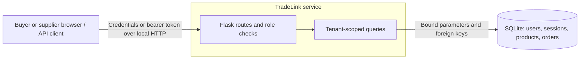

# TradeLink threat model

TradeLink models two independent trade workspaces. Each workspace contains a buyer and a supplier who intentionally share its catalog and orders. Both roles can read those records within their workspace. Suppliers publish products and mark orders shipped. Buyers place orders. A workspace is the tenant boundary.

The browser and API clients supply untrusted data. Flask establishes identity from the bearer token and looks up the role and workspace in SQLite. Request parameters and headers have no authority to select a workspace. The database is a separate trust boundary at the filesystem. Anyone who can modify it can change credentials, roles or data.

| Asset | Threat scenario | Controls exercised |
| --- | --- | --- |
| Order terms and fulfillment | Buyer guesses another workspace's order ID or supplier tries to modify it | Tenant predicates on reads and writes, uniform missing-object response |
| Catalog prices and costs | Search syntax escapes the tenant predicate or returns private fields | Bound SQL parameters, escaped search wildcards, explicit public projection |
| Product and order integrity | Buyer invokes supplier functions, or a caller supplies a tenant, cost, status or price | Server-side role checks, strict request fields, composite foreign key for product and workspace |
| Credentials and session tokens | Attacker guesses credentials, forges a token, or reuses a revoked token | Scrypt password hashes, generic login errors, random tokens with stored digests, one-hour expiry and logout |
| Browser responses | Framing, MIME sniffing, or HTML execution through product names | CSP, frame and MIME headers, rendering with text nodes, no-store on API responses |

Threat actors include unauthenticated callers, authenticated users from a different workspace and users with a lower privilege than the action requires. The host operator and local filesystem permissions are trusted. The vulnerable demonstration is a separate in-process fixture using fictional records.

This is a local assessment with HTTP on loopback. An internet-facing deployment would require TLS, managed user provisioning, credential rotation, rate limiting, audit logging, monitoring, and separate deployment and dependency review. The assessment excludes OS or filesystem compromise, service availability attacks, and third-party systems such as payment and shipping providers.
